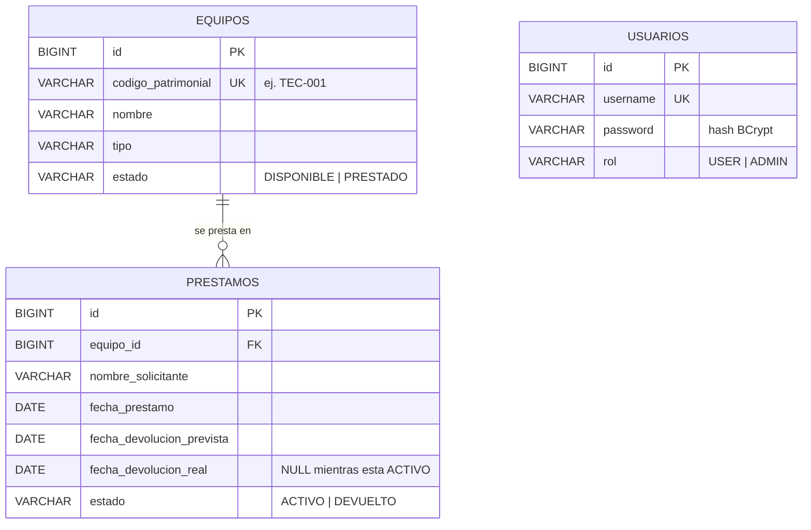

# Base de datos — TecnoUAM (préstamo de equipos)

Base de datos MySQL del sistema TecnoUAM. Las tablas coinciden columna por columna con las entidades JPA del backend
(`Usuario`, `Equipo`, `Prestamo`), así que la aplicación funciona sobre esta base
con el perfil `mysql` sin cambiar código.

## Archivos

| Archivo | Contenido |
|---|---|
| `01_esquema.sql` | Crea la base `tecnouam`, las 3 tablas, llaves, restricciones e índices |
| `02_datos.sql` | Usuarios de prueba, 12 equipos y 12 préstamos (8 devueltos, 4 activos) |
| `03_vistas.sql` | Vistas de reportes: préstamos activos, vencidos, inventario por tipo, uso por equipo, control de integridad |
| `04_procedimientos.sql` | Procedimientos para prestar, devolver y eliminar con las mismas reglas del API |
| `05_consultas.sql` | Consultas de ejemplo (equivalentes a los GET del API y reportes) |
| `instalar_todo.sql` | Ejecuta los scripts 01 a 04 en orden |

Requiere **MySQL 8.0.19 o superior** (probado en MySQL 8.4).

## Instalación

Desde esta carpeta:

```bash
mysql -u root -p < instalar_todo.sql
```

O uno por uno (también sirve desde MySQL Workbench abriendo cada archivo):

```bash
mysql -u root -p < 01_esquema.sql
mysql -u root -p < 02_datos.sql
mysql -u root -p < 03_vistas.sql
mysql -u root -p < 04_procedimientos.sql
```

Los scripts se pueden volver a correr sin duplicar datos. Para empezar de cero
(**borra todo lo que haya en la base `tecnouam`**):

```bash
mysql -u root -p -e "DROP DATABASE IF EXISTS tecnouam"
```

> Si la aplicación ya arrancó antes con el perfil `mysql`, Hibernate habrá creado
> las tablas sin estas restricciones y `01_esquema.sql` no las toca
> (`CREATE TABLE IF NOT EXISTS`). En ese caso borra la base y vuelve a instalar.

## Conectar el backend

Desde la raíz del repositorio:

```bash
export APP_PROFILE=mysql
export DB_HOST=localhost
export DB_NAME=tecnouam
export DB_USER=root
export DB_PASSWORD=tu_password
cd backend
./mvnw spring-boot:run
```

Cuentas sembradas: `admin` / `admin123` (ADMIN) e `instructor` / `instructor123`
(USER). En la tabla se guardan como hash BCrypt.

> **Error `Public Key Retrieval is not allowed`.** Con MySQL 8 la URL de
> `application-mysql.properties` (`useSSL=false`) puede fallar al arrancar,
> sobre todo justo después de reiniciar el servidor MySQL. La solución es agregar
> `allowPublicKeyRetrieval=true` a la URL de ese archivo, o sin tocar el código:
>
> ```bash
> export SPRING_DATASOURCE_URL='jdbc:mysql://localhost:3306/tecnouam?useSSL=false&allowPublicKeyRetrieval=true&serverTimezone=UTC'
> ```

## Modelo entidad-relación



`usuarios` no se relaciona con las otras tablas: el backend solo la usa para el
login con JWT, y el solicitante de un préstamo se guarda como texto
(`nombre_solicitante`), igual que en la entidad `Prestamo`.

## Reglas que garantiza la base

Además de lo que valida el backend en `EquipoService` y `PrestamoService`, la base
rechaza por sí misma los datos que rompen las reglas, aunque se inserten a mano:

| Regla | Cómo se aplica |
|---|---|
| Estados y roles solo con los valores de los enums Java | `CHECK` en `rol`, `equipos.estado` y `prestamos.estado` |
| Código patrimonial y usuario únicos | `UNIQUE` |
| Fecha prevista ≥ fecha de préstamo | `CHECK ck_prestamos_fecha_prevista` |
| Un préstamo `DEVUELTO` tiene fecha real; uno `ACTIVO` no | `CHECK ck_prestamos_devolucion_coherente` |
| Un equipo no puede tener dos préstamos `ACTIVO` | Columna generada `equipo_activo_id` + `UNIQUE` (ver abajo) |
| No se borra un equipo con préstamos registrados | `FOREIGN KEY ... ON DELETE RESTRICT` |
| Textos obligatorios no vacíos | `CHECK (CHAR_LENGTH(TRIM(...)) > 0)` |

**Un solo préstamo activo por equipo.** `prestamos.equipo_activo_id` es una columna
calculada que vale `equipo_id` mientras el préstamo está `ACTIVO` y `NULL` cuando
se devuelve. Como un índice `UNIQUE` admite varios `NULL`, un equipo puede tener
muchos préstamos devueltos pero solo uno activo. JPA no conoce esta columna y no
la necesita: MySQL la calcula sola.

## Vistas

| Vista | Muestra |
|---|---|
| `v_prestamos_detalle` | Cada préstamo con su equipo, situación (`EN CURSO`, `VENCIDO`, `DEVUELTO A TIEMPO`, `DEVUELTO CON RETRASO`), días de retraso y días en préstamo |
| `v_prestamos_activos` | Préstamos sin devolver |
| `v_prestamos_vencidos` | Préstamos sin devolver con la fecha prevista ya pasada |
| `v_inventario_por_tipo` | Total, disponibles y prestados por tipo de equipo |
| `v_uso_equipos` | Cuántas veces se prestó cada equipo y cuántas se devolvió tarde |
| `v_inconsistencias_estado` | Equipos cuyo estado no coincide con sus préstamos (debe estar vacía) |

## Procedimientos almacenados

Aplican las mismas reglas y mensajes de error que el API, dentro de una transacción:

```sql
CALL sp_registrar_prestamo(1, 'Juan Perez', '2026-11-18', '2026-11-25', @id);
SELECT @id;
CALL sp_devolver_prestamo(@id, NULL);   -- NULL = fecha de hoy
CALL sp_eliminar_equipo(12);            -- falla si tiene un préstamo activo
```

| Procedimiento | Errores posibles |
|---|---|
| `sp_registrar_prestamo` | Datos obligatorios vacíos, fecha prevista anterior, equipo no encontrado, equipo ya `PRESTADO` |
| `sp_devolver_prestamo` | Préstamo no encontrado, préstamo ya devuelto |
| `sp_eliminar_equipo` | Equipo no encontrado, equipo con préstamos activos |

Cada uno abre y confirma su propia transacción, así que no deben llamarse dentro
de otra transacción abierta.

## Datos de prueba

- **Equipos:** `TEC-001` a `TEC-012` (laptops, proyectores, tabletas, cámara,
  micrófono, parlante, monitor y kit Arduino). `TEC-001` a `TEC-003` son los mismos
  que crea `DataLoader`.
- **Préstamos:** 8 devueltos (2 con retraso) y 4 activos. Quedan `PRESTADO`
  `TEC-004`, `TEC-005`, `TEC-008` y `TEC-010`; el de `TEC-004` venció el
  2026-11-10. La situación `VENCIDO` se calcula con la fecha del día en que se
  consulta.
